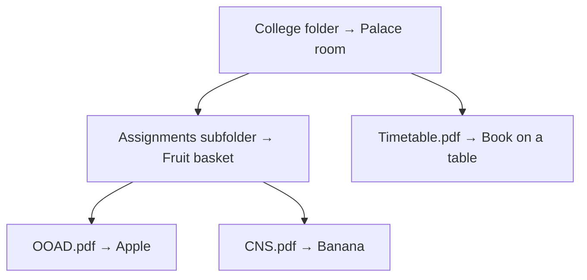

# FileQuest

### Never forget where you saved a file.

Explore your folders as places. Remember your files as objects.

[Concept](#the-concept) · [User Journey](#user-journey) · [Technology](#proposed-technology-stack) · [Documentation](#documentation)

---

## What is FileQuest?

FileQuest is a gamified memory palace file manager that turns local folders and files into places and objects inside an interactive 3D environment.

Instead of remembering a file path, you remember where its object belongs: **in a room, inside a basket, or somewhere in your virtual city.**

A React web interface connects to a local backend, which links virtual objects to real files on your computer.

## The Concept

Choose a palace, a city, or a customised environment. Your folder hierarchy becomes part of that world.

| On your computer | In FileQuest | Example |
| :--- | :--- | :--- |
| Folder | An explorable location | A palace room or city building |
| Subfolder | A container inside that location | A fruit basket |
| File inside a subfolder | An object inside the container | An apple inside the basket |
| File in the parent folder | A standalone object | A book on a table |

### A folder becomes a place

*Object choices above illustrate the concept; the assignment rules are still being planned.*

## User Journey

| Step | User action | Experience |
| :---: | :--- | :--- |
| 01 | **Start** | Open the dashboard and select Play. |
| 02 | **Choose** | Select a palace, city, or customised template. |
| 03 | **Explore** | Navigate rooms or buildings representing folders. |
| 04 | **Discover** | Explore containers and standalone file objects. |
| 05 | **Select** | Open a glassmorphism popup for a file object. |
| 06 | **Open** | Access the real file through the local backend. |

The popup is planned to include **Open** and **Open With** actions. Their exact operating-system behaviour is still being finalised.

## Planned Features

| Feature | Purpose |
| :--- | :--- |
| **3D memory palace** | Find files through spatial navigation. |
| **Environment templates** | Explore a palace, city, or customised setting. |
| **Nested containers** | Represent subfolders and their contents. |
| **Dynamic movement** | Navigate the environment and interact with objects. |
| **Multiple views** | Browse through directory, thumbnail, and 3D viewport views. |
| **File popup** | Access file actions through a glassmorphism interface. |
| **Persistent mappings** | Connect virtual objects to local file paths through a database. |

## Proposed Technology Stack

| Layer | Technology |
| :--- | :--- |
| Frontend | React |
| 3D rendering | React Three Fiber + Three.js |
| Styling | Tailwind CSS |
| Backend | Local server — technology TBD |
| Database | Local database — technology TBD |
| File storage | Existing files and folders on the user's computer |

## Project Progress

**Current phase: Concept and planning**

Our first milestone was preparing the handwritten design and documenting the user flow, visual file mappings, and proposed technology setup.

- [x] Define the initial project concept.
- [x] Sketch the application flow.
- [x] Document folder and file representations.
- [ ] Finalise the scope of the first version.
- [ ] Choose the backend framework and database.
- [ ] Define folder import and native file actions.
- [ ] Prepare OOAD models and UML diagrams.
- [ ] Build a prototype with one environment template.

> Features listed here are planned. Implementation has not started.

## Documentation

| Milestone | Document | Contents |
| :--- | :--- | :--- |
| **01 · Initial planning** | [Project Concept](docs/01_ProjectConcept.md) | Original idea, user journey, visual mappings, proposed setup, and open decisions |

---

An **Object-Oriented Analysis and Design** project.

**FileQuest — Never forget where you saved a file.**

